# FPS-OS

A 3D first-person web-based operating system built for Hackclub Stardance

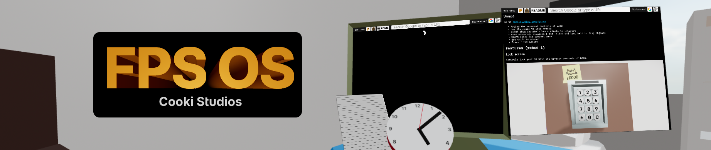

## Usage

Go to [cookistudios.com/fps-os](https://cookistudios.com/fps-os).

- Follow the movement controls of WASD
- Use the mouse to look around
- Click when crosshair has a circle to interact
- When crosshair displays a bar, click and keep held to drag objects
- Right click for context menu
- Use shift to crouch
- Press / for noclip

## Features (WebOS 1)

### Lock screen

Securely lock your OS with the default passcode of 0000.

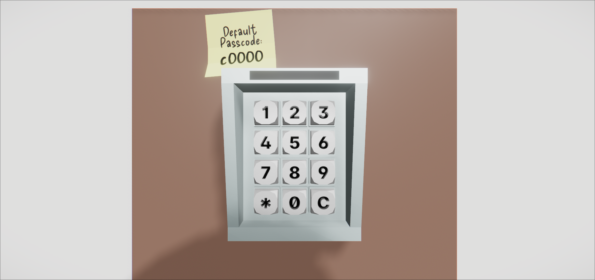

### Markdown text editor

Write messages and throw them out of the windows.

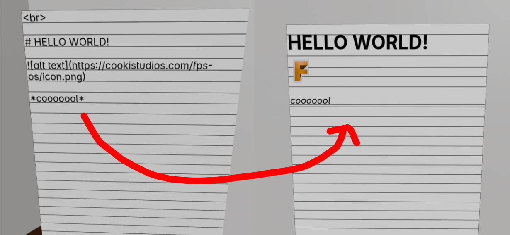

### Virtual machine/web browser

Take a gander at what the internet has to offer. Your history won't save.

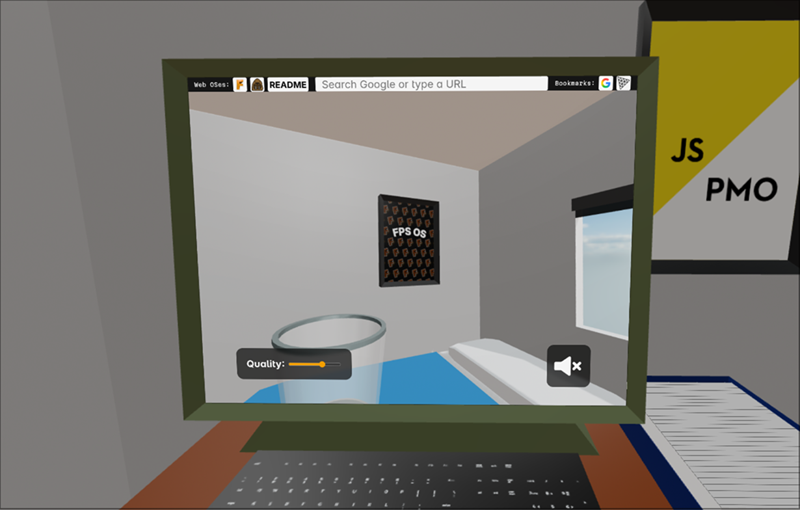

### Graphics quality presets

Put the FPS back in FPS OS by lowering rendering computation.

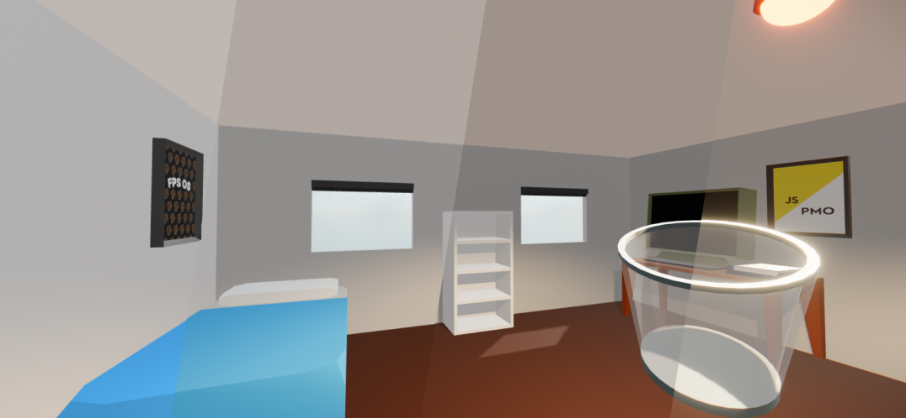

### Sleep mode

Leave the OS open without running. Don't count the Zs for too long or you might drift off aswell.

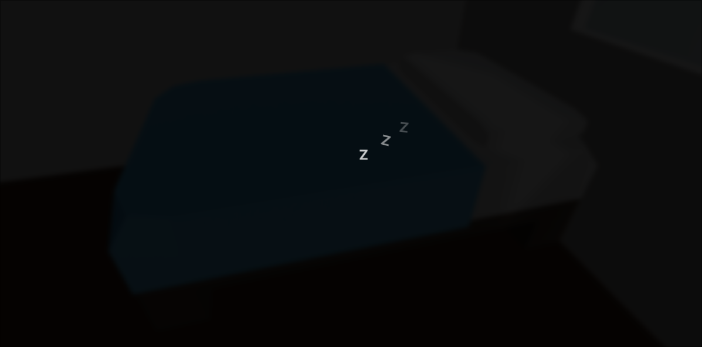

### Real-time clock

Read the time from an analog clock. Don't know how? Uh...

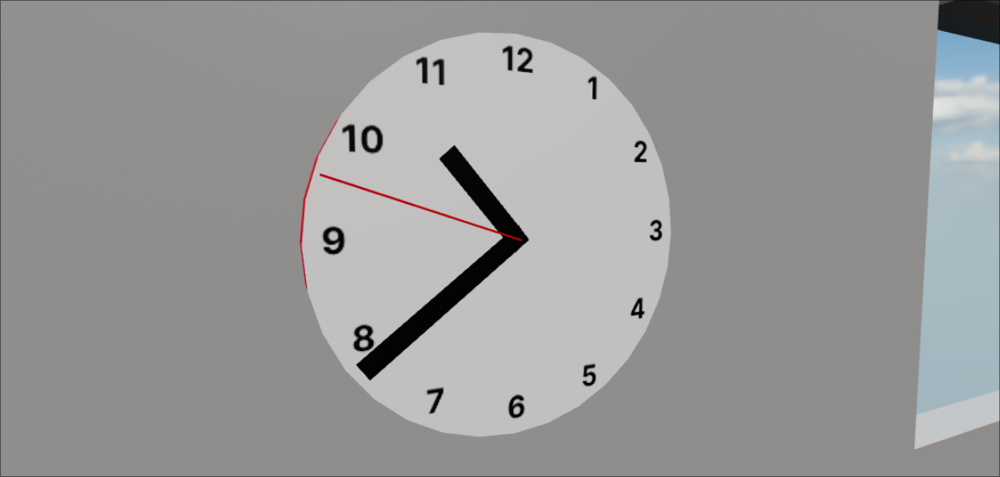

### Sound effects

Experience a fully 3D audio experience. The constant sound of the clock ticking reminds you of your mortality.

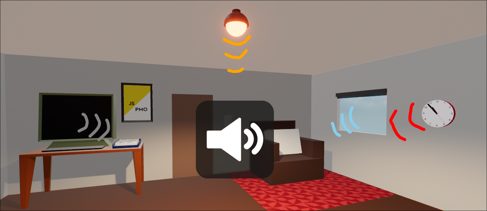

### Physics

Pick up and throw objects at will. The movement system lets you bhop.

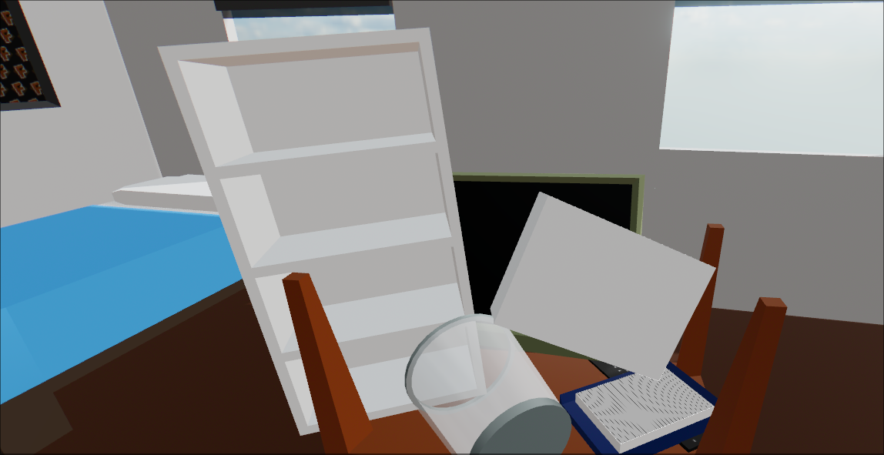

### Dark/Light mode

Stick to the default light mode or shut the blinds for a moodier vibe.

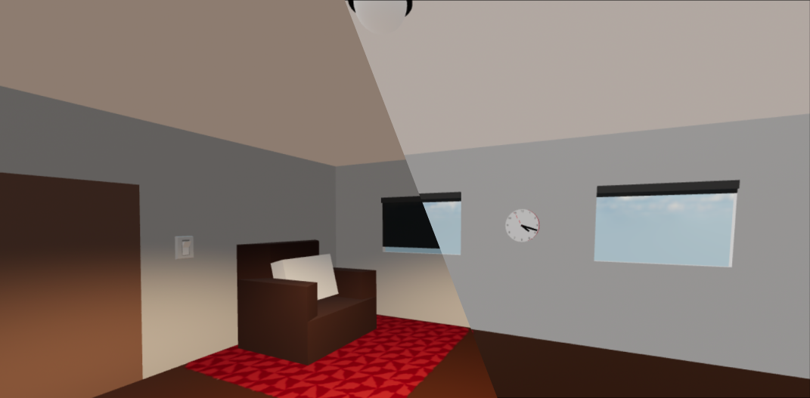

### Custom wallpaper

Right click a wall to access the context menu. Set your wallpaper to any image. It saves on reload.

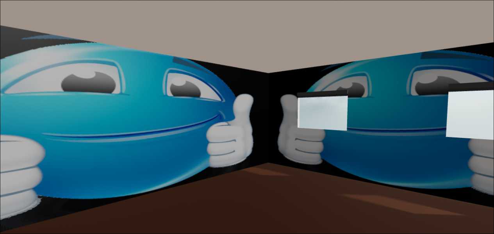

## Credits

Sound effects from freesound_community,
at https://pixabay.com/sound-effects

Song: NIVIRO - The Riot (Instrumental Version)
Music provided by NoCopyrightSounds
Free Download/Stream: http://ncs.io/TheRiot
Watch: http://ncs.lnk.to/TheRiotAT/youtube

[Hedges PNGs by Vecteezy](https://www.vecteezy.com/free-png/hedges)

Bullet hole images from https://techarthub.com/how-to-make-a-bullet-hole-in-substance-designer/
